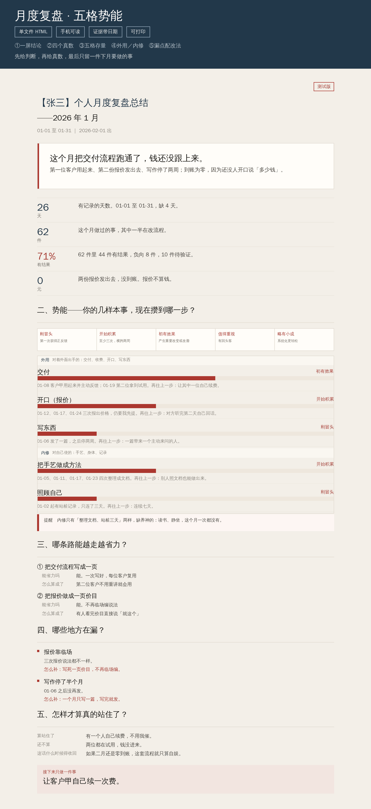

# monthly-growth-review

**把一个月的散落记录，压成一页能读的复盘——并告诉你，哪样本事真的升了级。**

测试版。五格尺与版式仍会调整。

中文 ｜ [English](#english)



<sub>图中数据为虚构示例，用来展示版式。</sub>

---

## 它解决什么

大多数月度总结是流水账：列了你做了什么，看不出攒下了什么。

这套东西只问五个问题，并要求每个答案带日期证据：做成了什么／哪样本事升了级／哪条路越走越省力／哪里在漏／怎样才算站住。

它不负责夸人。没人因你行动，它就直说。

## 安装脚本做了什么

不放心 `curl | bash` 就别用，可以手动来：

```bash
git clone https://github.com/dysoncool/monthly-growth-review.git
cp -R monthly-growth-review/skill <你的技能目录>/consulting/monthly-growth-review
```

`install.sh` 只有四件事：从本仓库取包 → 找技能目录 → 复制进去 → 清掉旧名字的目录。
不写系统文件，不装依赖，不联网上报。

## 安装

> 还没发布到 npm，`npx monthly-growth-review` 会 404。请用下面这条命令。

一条命令，不需要任何账号：

```bash
curl -fsSL https://raw.githubusercontent.com/dysoncool/monthly-growth-review/main/install.sh | bash
```

换目录：

```bash
AGENT_SKILLS_DIR=./skills bash install.sh
```


安装器会自动找技能根目录：`./skills` → `~/.agents/skills` → `~/skills`，都没有就建 `~/.agents/skills`。
## 月报放哪

安装器不替你决定。让技能自己算：

```bash
python3 <skills>/consulting/monthly-growth-review/scripts/where.py
```

找到 `principal/` 的库，就建议 `<你的库>/principal/monthly-review`；找不到才退到家目录 `~/monthly-review`。
确认后 `--base <路径>` 固定下来，下次不用再问。绝不放技能目录里。

## 更新

重跑同一条命令即可，会覆盖旧版并打印「旧版本 → 新版本」：

```bash
curl -fsSL https://raw.githubusercontent.com/dysoncool/monthly-growth-review/main/install.sh | bash
```

你的月报不在技能目录里，更新不影响数据。

## 第一次用

```bash
mkdir -p <你的库>/monthly-review
cp ~/.agent/skills/consulting/monthly-growth-review/templates/monthly-review-blank.html \
   <你的库>/monthly-review/2026-01-月度成长总结.html
```

改内容，不改结构；然后跑三条自检（结构 19 项／脱敏／连续性）。

## 五格档位

刚冒头（第一次获得正反馈）→ 开始积累（至少三次，横跨两周）→ 初有效果（产生重要改变）→ 值得重视（有回头客，或压力期没断）→ 略有小成（系统化、方法论、更轻松）。

分两组：**外用**（对着外面出手：交付、收费、开口、写东西、找资源）与**内修**（对自己使：手艺、身体、记录）。内修单薄必须写提醒，点名缺的读书、静坐、站桩。

## 月末自动出

一条定时任务：每月最后一天 21:00 触发；先查缺月；当月已出就跳过；失败必须吭声，不许静默。

## 边界

不含任何真实客户信息，不写死绝对路径，不允许断月出稿。

MIT License.

---

# English

An agent skill that turns a month of scattered notes into one readable review — and tells you which ability actually leveled up.

Beta. The five-level scale and page format may still change.

## What it solves

Most monthly reviews are diaries. They list what you did, not what accumulated.

This skill asks five questions and answers them with dated evidence:

1. What did you actually get done?
2. Which abilities moved up a level?
3. Which path gets easier each time?
4. Where are you leaking?
5. What would count as "standing on solid ground"?

It refuses to flatter. If nobody acted on your work, the review says so.

## Install

> Not on npm yet. `npx monthly-growth-review` returns 404 — use the command below.

One line, no account needed:

```bash
curl -fsSL https://raw.githubusercontent.com/dysoncool/monthly-growth-review/main/install.sh | bash
```

Custom skills root:

```bash
AGENT_SKILLS_DIR=./skills bash install.sh
```


The installer auto-detects your skills root: `./skills` → `~/.agents/skills` → `~/skills` → fallback `~/.agents/skills`.
## Where reports live

The installer never decides for you. Ask the skill's helper:

```bash
python3 <skills>/consulting/monthly-growth-review/scripts/where.py
```

It proposes `<your library>/principal/monthly-review` when it finds a `principal/` folder,
otherwise `~/monthly-review`. Confirm with `--base <path>` and the choice is remembered.
Never inside the skill folder.

## Update

Re-run the same command. It replaces the old version and prints `old → new`:

```bash
curl -fsSL https://raw.githubusercontent.com/dysoncool/monthly-growth-review/main/install.sh | bash
```

Your monthly reports stay where they are — the skill directory holds no data.

## First run

```bash
mkdir -p <your-vault>/monthly-review
cp ~/.agent/skills/consulting/monthly-growth-review/templates/monthly-review-blank.html \
   <your-vault>/monthly-review/2026-01-月度成长总结.html
```

Edit the content, keep the structure. Then:

```bash
python3 scripts/check_page.py <page.html>      # 19 structural checks
python3 scripts/check_clean.py <page.html>     # PII / path leak check
python3 scripts/check_continuity.py --base <your-vault>/monthly-review --start 2026-01
```

## The five levels

| Level | Meaning |
|---|---|
| 刚冒头 Emerging | First positive feedback |
| 开始积累 Accumulating | At least three times, across two weeks |
| 初有效果 Taking effect | A real change happened |
| 值得重视 Worth attention | Repeat customers, or held under pressure |
| 略有小成 Working | Systematized, methodized, easier |

Two groups: **external** (what you put out: delivery, pricing, writing) and **internal** (what you build in yourself: craft, body, records). If the internal side is thin, the report must say so and name what is missing — reading, meditation, standing practice.

## What's inside

| Path | Purpose |
|---|---|
| `skill/SKILL.md` | Method and definitions |
| `skill/INSTALL.md` | Install, first run, month-end cron |
| `skill/templates/monthly-review-blank.html` | Editable sample page |
| `skill/scripts/check_page.py` | 19 structural checks |
| `skill/scripts/check_clean.py` | PII / path leak check |
| `skill/scripts/check_continuity.py` | Month gap check |

## Month-end automation

One cron, one line of intent: run on the last day of the month at 21:00; check for missing months first; skip if this month is already out; never fail silently.

---


**把一个月散落的记录，变成一份能读的复盘，并告诉你哪样本事真的升了一级。**

测试版。五格口径与页面样式仍可能调整。


